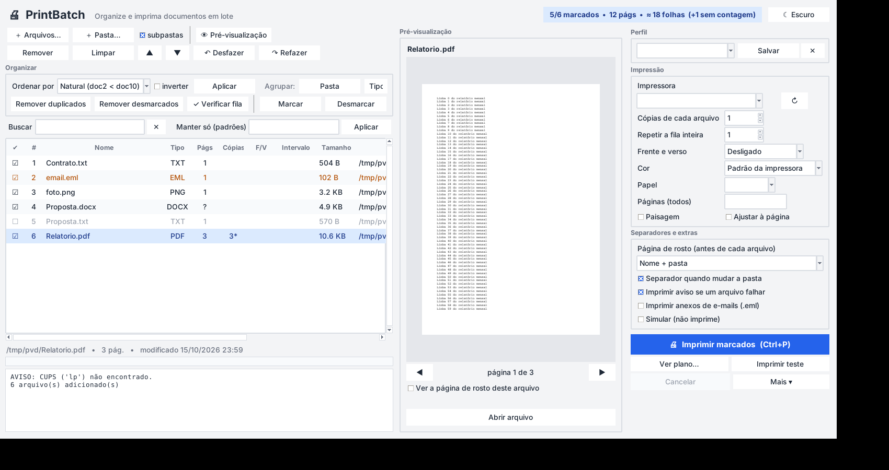
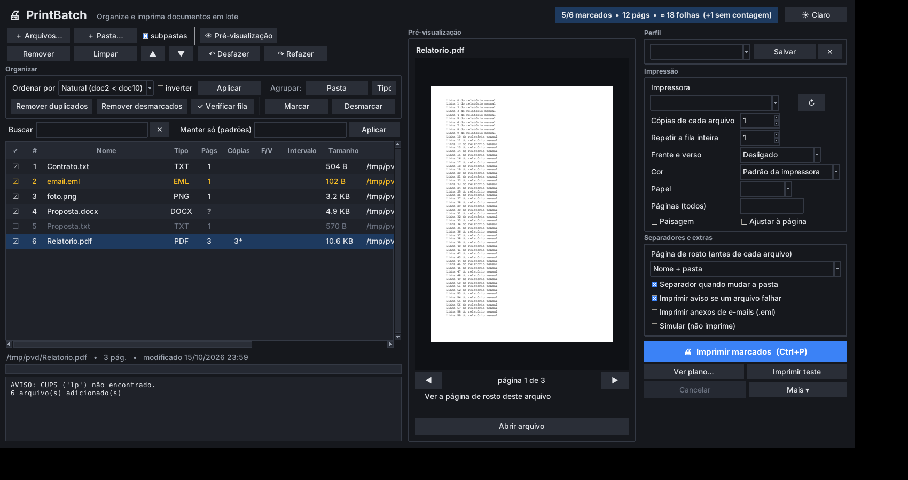

# PrintBatch — impressão em lote (Windows, Linux e macOS)

Imprime vários documentos de uma vez: **PDF, Word, Excel, PowerPoint, OpenDocument, RTF, HTML,
imagens, TXT e e-mails (.eml / .msg)**. Tem interface gráfica e linha de comando.




Visual moderno com **tema claro e escuro** (botão no canto superior direito, lembrado na próxima abertura),
linhas alternadas, cores de estado (✔ verde, ✘ vermelho, aviso âmbar) e texto nítido em telas de alta resolução.

## Pré-visualização e plano
- **Miniatura** da página do arquivo selecionado (PDF, Word/Excel/PowerPoint, imagens, texto, e-mail), com
  navegação página a página. Documentos Office são convertidos em segundo plano e guardados em cache.
- **Ver a página de rosto** do arquivo antes de imprimir.
- **Plano de impressão**: a sequência exata do que vai sair (separadores, rostos, arquivos), com folhas
  acumuladas — também na linha de comando: `--plan`.
- **Impressão de teste**: só a 1ª página de cada arquivo, 1 cópia, sem rosto — gasta pouco papel (`--test-print`).
- Requer `pypdfium2` e `pillow` (já em `requirements-windows.txt`). O painel abre sozinho em telas largas
  e pode ser ligado/desligado em “👁 Pré-visualização”.

## Organizar o que vai imprimir
- **Fila visual** com ☑ marcar/desmarcar cada arquivo (desmarcados ficam na lista, mas não imprimem).
- **Arrastar para reordenar**, ▲▼ (Alt+↑/↓), **desfazer/refazer** ilimitado (Ctrl+Z / Ctrl+Y).
- **Ordenar** por natural (`doc2` antes de `doc10`), nome, data, tamanho, tipo, pasta ou nº de páginas;
  **agrupar** por pasta ou tipo.
- **Contagem de páginas** (PDF, Word, PowerPoint, OpenDocument, texto) e **estimativa de folhas** de papel,
  levando em conta cópias, frente e verso, intervalos e páginas de rosto — atualizada ao vivo.
- **Ajustes por arquivo** (duplo clique): cópias, intervalo de páginas, frente e verso, cor e nota,
  só para aquele arquivo ou para a seleção.
- **Buscar** na fila (nome, pasta, nota) e **manter só** os que casam com padrões (`*.pdf, *contrato*`).
- **Verificar fila**: arquivo inexistente/vazio/ilegível, formato não suportado, PDF protegido,
  temporários (`~$…`, `Thumbs.db`), duplicados idênticos e falta de Office/LibreOffice. Dá para
  remover ou desmarcar os problemáticos. **Remover duplicados** com um clique.
- **Separador de pasta** (página que avisa quando muda a pasta), **página de rosto** por arquivo,
  **repetir a fila inteira** N vezes (conjuntos) e **duplicar** um item para reimprimir.
- **Perfis** (conjuntos de opções com nome) e **projetos `.pbq`** que guardam fila, ajustes por arquivo e opções.
- Arrastar e soltar arquivos do Explorer, botão direito (abrir, mostrar na pasta…), progresso, cancelar,
  log e **relatório** CSV/JSON. Modo **simulação**.
- Impressão: impressora, cópias, frente e verso (borda longa/curta), cor ou P&B, papel, paisagem,
  ajustar à página, intervalo de páginas; e-mails `.eml`/`.msg` com anexos opcionais.

## Windows — instalação
1. Instale o Python 3.12 (ou use `instalar.bat`, que usa o `winget`).
2. Execute **`instalar.bat`**: instala `pywin32`, `tkinterdnd2` e o **SumatraPDF**.
3. Execute **`executar.bat`** para abrir o programa.
4. (Opcional) **`criar_atalho_enviar_para.bat`**: adiciona “Enviar para > PrintBatch” no botão direito.
5. (Opcional) **`build_exe.bat`** gera `dist\PrintBatch.exe` sem precisar de Python
   (o GitHub Actions também gera, em *Actions > Build PrintBatch (Windows) > Artifacts*).

### Como imprime no Windows
| Tipo | Caminho |
|---|---|
| Word / Excel / PowerPoint | exporta para PDF com o próprio Office (pywin32); se não houver, usa LibreOffice |
| PDF, imagens, TXT, e-mail | PDF/imagem enviado ao **SumatraPDF** com todas as opções |
| .msg | lido pelo Outlook (pywin32) |

Sem o SumatraPDF o programa ainda imprime pelo verbo `printto` do Windows, **mas sem cópias, frente e
verso, papel e páginas** (aparece um aviso).

## Linha de comando
```bat
python batch_print.py --list-printers
python batch_print.py "C:\Docs" -r -p "Minha Impressora" -n 2 --duplex long --cover filename-folder --failed-page --report fila.csv
python batch_print.py *.docx --sort date --filter "*relatorio*" --dry-run
python batch_print.py "C:\Docs" -r --stats                 # páginas e folhas estimadas
python batch_print.py "C:\Docs" -r --check                 # verifica problemas e duplicados
python batch_print.py "C:\Docs" -r --sort folder --folder-divider --save-project lote.pbq
python batch_print.py --project lote.pbq                    # imprime um projeto salvo
python batch_print.py "C:\Docs" -r --plan --cover full      # sequência exata do que sairia
python batch_print.py "C:\Docs" -r --test-print -p "HP"     # só a 1ª página de cada arquivo
```
Sem argumentos abre a interface gráfica. Veja `python batch_print.py --help`.

## Linux / macOS
Funciona via CUPS (`lp`); Office converte com LibreOffice. A GUI precisa de `python3-tk`.

## Testes
```
python -m unittest discover -s tests
```
